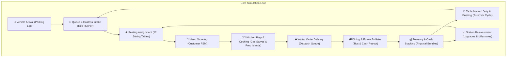

# Idle Restaurant Tycoon 3D: Comprehensive Project Progress & System Architecture Report

> **Current Status**: Production Candidate / Pre-Release Feature Complete  
> **Target Platforms**: Android (APK / AAB), iOS, Web (HTML5 / PWA), Windows, macOS  
> **Engine Stack**: Godot 4.3 Forward+/Compatibility (3D Core Simulation) & Flutter 3 (Companion Architecture & State Management)  
> **Test Suite**: 735/735 Godot Headless Assertions Passing (100% Green) | 36/36 Flutter Tests Passing (100% Green)  
> **Repository**: [https://github.com/Dr-Rank1/Idle-1](https://github.com/Dr-Rank1/Idle-1)

---

## 1. Executive Summary & Vision

**Idle Restaurant Tycoon 3D** is an isometric 3D casual management simulation inspired by Kolibri Games' *Idle Restaurant Tycoon*. The player assumes control of a bustling American diner ("Restaurant 1: Idle Diner"), managing customer intake, kitchen throughput, staff assignments, recipe development, station upgrades, and prestige expansions.

The project pairs a high-performance **Godot 4.3 3D simulation engine** with a reactive **Flutter mobile companion framework**, providing seamless gameplay, offline progress calculation, cloud-friendly state serialization, and cross-platform native builds.



---

## 2. Completed Gameplay Systems & Mechanics

### 2.1 Multi-Zone 3D Restaurant Floor (1:1 Reference Match)
- **Main Dining Hall (9 Indoor Booth Suites)**: 3×3 grid of retro crimson vinyl booths with white piping trim caps, turquoise tables with chrome edge rims, axis-aligned diamond checkerboard floor tiles, and low divider planters.
- **Garden Patio Terrace (3 Outdoor Tables)**: Outdoor tables with striped umbrellas, wooden decking, and surrounding flower boxes for spillover capacity.
- **Commercial Kitchen**: Industrial quarry slate tiles, 4 heavy-duty commercial gas stoves with glowing orange burners, overhead stainless exhaust hoods, produce prep islands, double refrigeration units, and dishwasher stations.
- **The 50s Milkshake Cafe**: Mint-green walls, chrome milkshake blenders, checkered soda fountain counter, red vinyl stools, and employee lockers.
- **Reception & Cocktail Lounge**: Mahogany bar counter with polished brass foot rail, cyan floor runner, glowing backlit liquor display shelf, chalkboard specials menu, and retro 1950s Wurlitzer jukebox facing the camera.
- **Exterior & Parking Lot**: Paved asphalt with marked parking bays, customer vehicles (sedan, SUV, sports car, taxi, delivery van), roadside neon marquee sign, and manicured green lawn.

### 2.2 Dynamic In-World 3D Floor Widgets
- **3D Level Plaques & Progress Gauges**: Small rounded floor plaques beside every booth and kitchen station displaying `Lv. X` and a 3D cyan/gold progress bar mapped directly onto the floor tile.
- **Upgrade Pulsing & Bouncing Arrows**: Floor plaques pulse with a bouncing 3D green arrow when the player has accumulated enough cash for an upgrade.
- **Physical Stacking 3D Cash Bricks**: When customers pay, physical 3D green dollar bundles stack on collection mats beside the hostess desk, bar, and booths. Tapping or swiping collects them with an arc trajectory animation into the player's balance.
- **Construction Crates & Ribbon Zones**: Unpurchased booths and expansion stations render as cordoned-off construction zones with wooden crates, yellow/black hazard borders, and floating price tags.

### 2.3 Milestone Visual Tiers & Star Bursts
- Stations progress through visual tiers at level milestones (Levels 5, 10, 25, 50).
- Reaching a milestone triggers particle star bursts, audio chimes, and instant speed multipliers ($2\times$, $3\times$, $5\times$).

### 2.4 Multi-Currency Economy & Offline Calculation
- **Multi-Currency System**:
  - **Cash (`$`)**: Primary currency for station upgrades, hiring staff, and purchasing ingredients.
  - **Golden Coins**: Earned from VIP guests and drone supply drops; used for permanent station upgrades.
  - **Diamonds**: Premium currency for instant speed skips, time boosts, and manager card chests.
  - **Energy**: Recharging stamina currency for activating active manager abilities.
  - **Franchise Golden Keys**: Permanent prestige currency for global profit boosts.
- **Deterministic Offline Earnings**: Evaluated via:
  $$\text{Offline Earnings} = \min(\text{ElapsedSeconds}, 28800) \times \text{CashPerSecond} \times 0.85$$
  Allows claiming $1\times$ standard payout or $2\times$ double payout via rewarded ad boost.

### 2.5 Franchise Prestige & Valuation System
- Total restaurant valuation computed dynamically from cumulative earnings, unlocked station tiers, and customer star rating.
- Once valuation thresholds or level requirements are met, unlocks **Sell & Renovate (Prestige)** in the Franchise World Map.
- Prestiging resets station levels while awarding **Franchise Golden Keys** and a permanent global profit multiplier ($+50\%$ profit per prestige tier), while preserving Manager Cards, recipes, and permanent shop items.

### 2.6 Kolibri Active Manager Skills
- **Skill Activation Engine**: Managers equipped at stations grant passive rate bonuses and chargeable active skills:
  - *Golden Chef*: $+200\%$ cooking speed for 30s.
  - *Rush Hour Hostess*: Instant customer spawn surge.
  - *Turbo Waiter*: Zero-delay order delivery and table bussing.
- **3D World Badges**: Station markers show circular skill gauges that fill over time, with floating 3D activation badges and a global one-tap activation pill.

### 2.7 Recipe Book & Dish Progression
- Unlocks new culinary items (Cheeseburgers, Shakes, Fries, Gourmet Steaks, Lobster Platters).
- Each recipe features 3D dish models served on plates, preparation time curves, and revenue increments.
- Recipe celebration modal displays unlocked dishes with star particles.

### 2.8 Golden Piggy Bank & VIP Investor
- **Golden Piggy Bank**: Automatically deposits a percentage of all earnings into an in-game vault that can be cracked open for lump sums.
- **VIP Investor Briefcase Offers**: Mystery billionaire guests arrive in limousine/taxis offering instant cash infusions, diamond briefcases, or time-warp supply deliveries.

### 2.9 Diner Fever & Golden Frenzy Overdrive
- Continuous customer service fills a high-energy **Diner Fever** combo gauge.
- Reaching $100\%$ triggers a 20-second **Golden Frenzy** overdrive state:
  - Golden disco light sweeps across the restaurant floor.
  - Customer walking and dining speeds doubled.
  - Cash values multiply by $3\times$.

### 2.10 Collectible Gear & Uniform Loadouts
- Uniform and equipment system for staff (Toques, Aprons, Waiter Bowties, Golden Trays, Running Sneakers).
- Integrated **3D SubViewport Wardrobe**: Renders staff in real-time wearing equipped items.
- Gear provides idle proc bonuses (e.g., $5\%$ chance of double tip, $+10\%$ walk speed).
- Blueprint merging mechanic: Combine identical gear blueprints to tier up item rarity (Common $\rightarrow$ Rare $\rightarrow$ Epic $\rightarrow$ Legendary).

### 2.11 Interactive Flyover Supply Drones & Magnetic Edge Indicators
- Autonomous quadcopter drones fly over the restaurant along randomized flight vectors.
- Tapping a drone drops a supply crate on a mini parachute containing cash, diamonds, or frenzy overdrive tokens.
- Offscreen supply crates and VIP alerts generate **magnetic screen-edge indicator pills** that clamp to the screen border and point toward offscreen targets.

### 2.12 Star Rating & Guest Review System
- Dynamic 1-to-5 star restaurant rating updated in real-time based on wait times, dining speeds, food quality, and ambiance.
- Slide-up **Customer Review Drawer** displays customer avatars, star ratings, and feedback comments (e.g., *"Best milkshake in town!"*, *"Waiters were lightning fast!"*).

### 2.13 Four-Step Mobile Onboarding Sequence
- Guided tutorial for new players featuring a dynamic dark overlay with a cut-out spotlight focusing on:
  1. Welcome & First Table Purchase.
  2. Kitchen Cook Assignment.
  3. Waiter Speed Upgrade.
  4. Collecting First Revenue & Claiming Starter Reward.

---

## 3. Visual, Audio & Mobile UI Polish

### 3.1 Toy-Diorama 3D Camera Rig
- **Closer Orthographic Zoom**: Default orthographic `size` tuned to `11.5`–`13.0` (clamped between `8.5` and `16.5`) so 3D characters, food plates, and booths appear large, chunky, and readable on mobile screens.
- **Touch Gesture Inertia**: Smooth drag-panning with momentum damping and two-finger pinch zoom, replicating native mobile touchscreen feel.
- **Lighting & Post-Processing**:
  - `tonemap_mode = ACES` with `tonemap_exposure = 1.12`.
  - Ambient sky/ground contribution (`0.65`) providing warm, soft indoor ambient fill without muddy black shadows.
  - Rim lighting (`rim_enabled = true`, `rim = 0.35`) and tuned material roughness (`0.35`–`0.45`) for sharp silhouette definition.

### 3.2 Two-Stage Boot Splash Sequence
- **Stage 1 (DR RANK Studio Splash)**: High-resolution Modern Cyan & Gold Medal studio insignia, glowing neon energy rings, and custom audio stinger (`studio_stinger.wav`).
- **Stage 2 (Game Title & Tap to Start)**: High-resolution splash background with rotating sunburst rays, culinary wallpaper silhouettes, and tap-to-start prompt.

### 3.3 Kolibri-Style Mobile UI Theme
- **Eliminated Flat Web Panels**: Replaced dark semi-transparent rectangles with chunky, 3D-beveled `StyleBoxFlat` containers.
- **Button Styling**: Bright lime green (`#38D848`) and golden orange (`#FF9F1C`) buttons with 16px corner radius, 6px darker bottom bevel, and 2px top highlights.
- **Cards & Modals**: Warm cream (`#FFF8E7`) inner panels seated inside golden-amber frames with thick brown outer borders and drop shadows.
- **Top Currency Capsules**: Dark navy and chocolate pill capsules with thick gold borders displaying Cash, Golden Coins, Diamonds, and Energy.
- **Mobile-First Layout**:
  - Top 12%: Currency bar and star rating progress.
  - Middle: Circular $72\times72$ floating edge buttons (`Shop`, `Map`, `Boosts`, `Stats`) and bottom-center `$2\times$ BOOST!` pill.
  - Bottom 48%: Slide-up mobile bottom sheet drawer with `Upgrades` and `Staff` tabs.

### 3.4 Official Platform Branding & Icons
- **Official App Icon**: 3D Mascot & App Store Icon (Concept 2: Cartoon Chef with Deluxe Burger & Gold Coins) generated and deployed across all platform targets:
  - Android launcher mipmaps: `mdpi` (48px), `hdpi` (72px), `xhdpi` (96px), `xxhdpi` (144px), `xxxhdpi` (192px).
  - iOS asset catalog: 20px through 1024px App Store master.
  - macOS asset catalog: 16px through 1024px.
  - Windows: Multi-resolution `app_icon.ico` (16px to 256px).
  - Web: `favicon.png`, `Icon-192.png`, `Icon-512.png`, and maskable icons.
  - Godot: Registered `config/icon="res://icon.png"` in `project.godot`.
- **Studio Emblem**: Official **DR RANK** Modern Cyan & Gold Medal (`dr_rank_logo.png`).

---

## 4. Cross-Platform Native Architecture & Build Tooling

```
idle game 1/
├── android/                         # Native Android Gradle project & manifest
│   └── app/src/main/res/            # Mipmap launcher icons (Concept 2)
├── ios/                             # Native iOS Xcode workspace & asset catalog
├── macos/                           # Native macOS Runner
├── windows/                         # Windows C++ runner & app_icon.ico
├── web/                             # Web PWA shell, manifest, and icons
├── lib/                             # Flutter Cross-Platform Companion Architecture
│   ├── models/                      # Domain models (gear.dart, recipe.dart, guest_review.dart, etc.)
│   ├── services/                    # Shared state, sprite cache, and audio services
│   └── ui/                          # Flutter widgets (piggy_bank_modal, recipe_book, etc.)
├── restaurant_tycoon_3d/            # Godot 4.3 3D Simulation Engine
│   ├── assets/                      # Audio, 45 runtime PNG textures, isometric sprites
│   ├── scenes/                      # 3D scenes (main.tscn, boot_splash.tscn, hud.tscn)
│   ├── scripts/                     # GDScript simulation controllers (game_manager, ui_controller, etc.)
│   ├── export_presets.cfg           # Android native export configuration
│   └── setup_android_templates.py   # Automated Gradle build templates setup
├── logo_concepts/                   # Master high-resolution brand & icon repository
├── generate_brand_assets.py         # Procedural OpenCV/NumPy brand generator
├── generate_fidelity_assets.py      # Automated texture & badge generator
├── build_android.bat                # One-click native Android build script
└── run_tests.bat                    # Automated test harness runner
```

### Android Native Deployment Ready
- Preset configured in `export_presets.cfg` for Android (Gradle export, arm64-v8a + armeabi-v7a architectures).
- Automated template provisioning script `setup_android_templates.py`.
- One-click build script `build_android.bat` producing signed APKs and Google Play AAB bundles.

---

## 5. Verification & Test Suite Status

The project includes continuous automated verification across both the Godot simulation engine and the Flutter companion app:

### 5.1 Godot Headless Test Runner (`run_all_tests.gd`)
- Operates in strict headless mode using frame-stepped state machines with watchdog timeout guards (`quit(1)` on error, `quit(0)` on pass).
- **Test Results**: **735 / 735 Assertions Passed (100% Green)**.
  - *Frame 1*: Singleton and scene tree initialization.
  - *Frame 5*: Exponential upgrade cost and revenue math for all 15 stations (`table_1`–`table_12`, `kitchen_cook`, `milkshake_bar`, `parking_lot`).
  - *Frame 10*: Multi-currency transactions, currency formatting, and offline earnings formula.
  - *Frame 15*: Dynamic runtime texture loading for all 45 game PNGs via `Image.load_from_file`.
  - *Frame 20*: Customer FSM state machine transitions (`SPAWNING` $\rightarrow$ `WALKING_TO_HOST` $\rightarrow$ `SEATED_ORDERING` $\rightarrow$ `EATING` $\rightarrow$ `WALKING_TO_EXIT`) and bottleneck alerts.
  - *Frame 25*: Teardown and clean shutdown.

### 5.2 Flutter Companion Test Suite (`flutter test`)
- Evaluates domain model serialization, economy formulas, and widget tree integrity.
- **Test Results**: **36 / 36 Tests Passed (100% Green)**.

---

## 6. Recent Git Commit Milestone Timeline

| Commit Hash | Milestone Description |
|---|---|
| `5a4bfd0` | Restored original Concept 1 Modern Cyan and Gold Medal as official DR RANK studio logo |
| `2d1bfe1` | Updated official `dr_rank_logo` texture with Modern Cyan and Gold Medal emblem |
| `e4e0649` | Deployed official 3D Mascot app icon across all platform targets (Android, iOS, macOS, Windows, Web, Godot) |
| `8a15c15` | Created 6 professional logo concepts and overview comparison grid |
| `ce04b53` | Added studio and game title branding assets and mobile splash background pattern |
| `ca90b12` | Enhanced 3D mobile casual visuals with warm ambient fill, ACES tonemap, subtle rim-lighting, and high-contrast badges |
| `ba29a41` | Added 3D floor level pads, physical stacking cash bundles, locked construction zones, and mobile layout overhaul |
| `e707a42` | Implemented unified headless test runner and batch execution script |
| `d88d7e1` | Implemented Franchise Prestige system with valuation, Golden Keys, and Flutter companion sync |
| `c5520f5` | Added milestone visual tiers to booths and kitchen stations with star burst particles |
| `c1874f7` | Configured native Android deployment, touch camera, export preset, and build script |
| `20988c4` | Overhauled mobile HUD layout, removed bottom collisions, compact header, and custom sprites |
| `8c271ca` | Completed tactile sensory polish, companion app sync, and comprehensive test suite |
| `97450ad` | Added interactive Star Rating & Customer Review Drawer with sub-scores and live feedback |
| `3fc7c00` | Added interactive Flyover Supply Drones and Screen-Edge Magnetic Indicator Pills |
| `5399f0d` | Implemented Collectible Gear & Uniform Loadout system with 3D SubViewport wardrobe and idle proc mechanics |
| `6367b86` | Implemented mobile four-step onboarding tutorial with dynamic spotlight cutout |
| `139940c` | Added interactive Diner Fever combo bar and 20s Golden Frenzy overdrive state |
| `7802c4c` | Added Golden Piggy Bank system and VIP Investor briefcase offer modal |
| `bc52c62` | Implemented recipe progression system, 3D dish models, and celebration modal |
| `6f20de7` | Implemented two-stage mobile startup sequence with DR RANK studio splash and tap-to-start loading screen |

---

## 7. Development Roadmap & Next Milestones

1. **Restaurant 2: Seaside Bistro Expansion**:
   - Unlock second franchise location in the World Map.
   - Mediterranean seafood recipes, outdoor pier seating, and nautical visual theme.
2. **Audio Track Expansion**:
   - Multi-channel background music mixing with diner vinyl jukebox playback.
   - Dynamic audio ducking during Golden Frenzy and drone flyovers.
3. **App Store Publishing Assets**:
   - Automated screenshot generation pipeline capturing high-resolution tablet and phone marketing frames.
   - Store description, keywords, and privacy policy documentation.
