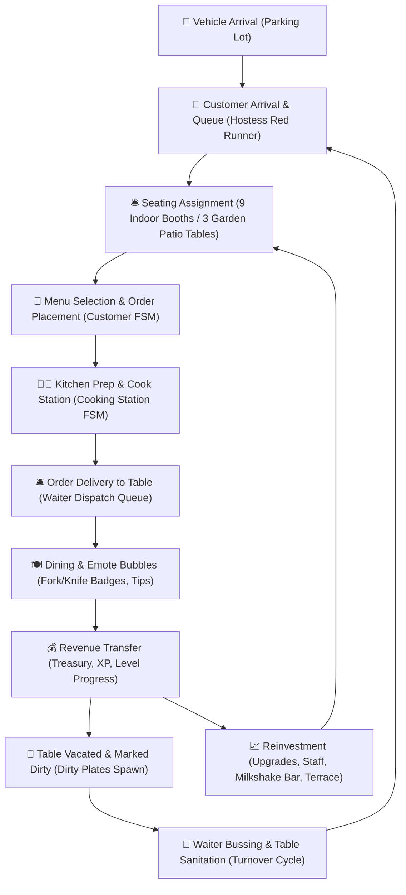
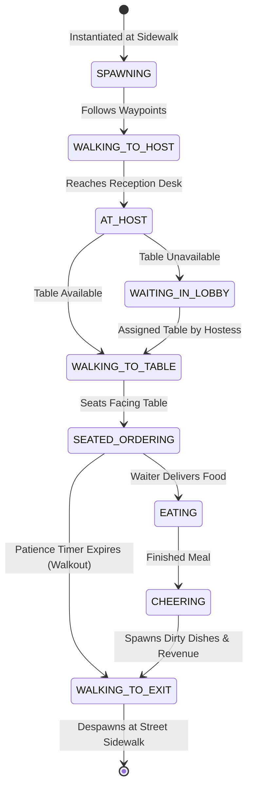

# Idle Restaurant Tycoon 3D: Comprehensive System Architecture & Development Overview

> **Target Audience**: Human Engineers, Technical Leads, and Autonomous AI Assistants (Gemini / Antigravity).  
> **Repository Context**: Complete 3D simulation codebase pairing a Godot 4.3 Forward+/Compatibility game engine with a Flutter mobile management companion framework.  
> **Visual Reference Target**: 1:1 fidelity with Kolibri Games' *Idle Restaurant Tycoon* (Restaurant 1: "Idle Diner", reference frame series `ref_frames/res1_*.jpg`).

---

## 1. Executive Summary & Design Philosophy

**Idle Restaurant Tycoon 3D** is an isometric 3D incremental management simulation game. The player assumes the role of a restaurant owner and head operator, managing floor throughput, staff efficiency, kitchen cooking pipelines, aesthetic station tiers, customer satisfaction, and economic expansion.

The game is architected around two synchronized layers:
1. **The Godot 4 Simulation Engine (`restaurant_tycoon_3d/`)**: Handles real-time 3D spatial rendering, character kinematics and animations, pathfinding, guest lifecycle finite state machines (FSM), kitchen preparation loops, physics interaction, and in-world 3D user interfaces.
2. **The Flutter Mobile Architecture (`lib/`, `android/`, `ios/`)**: Provides a cross-platform companion shell, persistent offline state management, clean architecture service layers, and mobile presentation patterns.

### Core Simulation Loop



---

## 2. Spatial Architecture & Interior Layout (1:1 Reference Match)

The spatial layout is modeled 1:1 after *Idle Restaurant Tycoon* (Restaurant 1: *Idle Diner*). The restaurant interior comprises four distinct operational zones plus outdoor extensions, rendered through an orthographic isometric camera:

```
+-------------------------------------------------------------------------------------------------------+
|                                    NORTH (Z = -10.5m)                                                 |
|  +--------------------------------+  +--------------------------------------------------------------+ |
|  |  THE 50s MILKSHAKE CAFE        |  |  COMMERCIAL KITCHEN                                          | |
|  |  - Mint-green retro walls      |  |  - Commercial slate-grey quarry tiles (kitchen_slate_tiles)   | |
|  |  - Diamond checkerboard floor  |  |  - 4 Heavy-duty gas stoves with orange glowing burners      | |
|  |  - Soda fountain bar counter   |  |  - Stainless steel vent hood exhaust canopy                  | |
|  |  - Chrome blenders, sundaes    |  |  - Prep islands with cutting boards & fresh produce crates    | |
|  |  - 4 Square diner tables       |  |  - Double commercial refrigerators & dishwashing sinks        | |
|  |  - Industrial employee lockers |  |  - 4 Active chefs in tall white toques                        | |
|  +--------------------------------+  +--------------------------------------------------------------+ |
|                 | (Divider Wall Z = -3.5m)                      | (Kitchen Pass Counter & Silver Lamps) |
|  +--------------------------------+  +--------------------------------------------------------------+ |
|  |  COCKTAIL LOUNGE / RECEPTION   |  |  MAIN 9-BOOTH DINING HALL                                    | |
|  |  - Warm terracotta walls       |  |  - Axis-aligned diamond checkerboard floor tiles             | |
|  |  - Cherry mahogany bar counter |  |  - 9 Red leather booths with white retro piping caps         | |
|  |  - Polished brass foot rail    |  |  - Turquoise/cyan tabletops with chrome edge rims            | |
|  |  - Cyan runner floor mat       |  |  - Low white divider planters with lush green flowers        | |
|  |  - Glowing backlit bottle shelf|  |  - 4 Seated diners per booth with varied clothing/hair       | |
|  |  - Framed chalkboard menu      |  |  - Floating circular badges (Fork/Knife & Hourglass)         | |
|  |  - 4 Mahogany round tables     |  |  - Floating green cash stacks ($100, $2.8T, $172T, $1.03T)   | |
|  |  - Red cone pendant lamps      |  |  - Large crimson red runner rug in front of pass counter     | |
|  |  - 1950s Wurlitzer Jukebox     |  |  - Mounted Wall TV broadcasting diner program                | |
|  |  - Hostess reception desk      |  |                                                              | |
|  +--------------------------------+  +--------------------------------------------------------------+ |
|                                                                     | (Glass Balustrade Railing)      |
|  +--------------------------------+  +--------------------------------------------------------------+ |
|  |  FRONT LAWN & ROAD SIGN        |  |  GARDEN PATIO TERRACE                                        | |
|  |  - "Idle Diner" neon sign      |  |  - Polished outdoor parquet deck                             | |
|  |  - Trimmed manicured hedges    |  |  - Tables 10, 11, 12 with striped parasol umbrellas          | |
|  |  - Topiary cones & round trees |  |  - Turquoise cafe tables, outdoor chairs, patio diners       | |
|  |  - Glass sliding entrance doors|  |                                                              | |
|  +--------------------------------+  +--------------------------------------------------------------+ |
|                                    SOUTH (Z = +10.5m)                                                 |
|  +--------------------------------------------------------------------------------------------------+ |
|  |  ACTIVE PARKING LOT & STREET (Z = +15.2m to +22.0m)                                               | |
|  |  - Dark asphalt highway with white lane markers, zebra crosswalk, and street lamps               | |
|  |  - 5 Angled parking bays with active traffic: Taxi, Sedan, SUV, Delivery Van, Sports Hatchback   | |
+-------------------------------------------------------------------------------------------------------+
```

### Coordinate & Boundary Mapping

| Room / Zone | X Range (meters) | Z Range (meters) | Floor Material & Texture |
| :--- | :--- | :--- | :--- |
| **Cocktail Lounge / Reception** | $[-11.5, -3.5]$ | $[-3.5, +10.5]$ | Warm cream cabochon / parquet (`reception_tiles.png`) |
| **The Milkshake Diner Cafe** | $[-11.5, -3.5]$ | $[-10.5, -3.5]$ | High-contrast diamond checkerboard (`diner_diamond_tiles.png`) |
| **Restroom** | $[-3.5, +2.5]$ | $[-10.5, -3.5]$ | Cool blue-grey square tiles (`restroom_tiles.png`) |
| **Commercial Kitchen** | $[+2.5, +10.5]$ | $[-10.5, -3.5]$ | Commercial checkered tile (`kitchen_tiles.png`) |
| **Manager's Office** | $[+10.5, +18.5]$ | $[-10.5, -3.5]$ | Warm terracotta quarry tiles (`kitchen_terracotta.png`) |
| **Staff Breakroom** | $[+10.5, +18.5]$ | $[-3.5, -0.5]$ | Slate-grey quarry tiles (`kitchen_slate_tiles.png`) |
| **Main 9-Booth Dining Hall** | $[-3.5, +10.5]$ | $[-3.5, +10.5]$ | Axis-aligned diamond checkerboard (`diner_diamond_tiles.png`) |
| **South-East Booth Expansion (Tables 10–12)** | $[+10.5, +16.0]$ | $[-0.5, +10.5]$ | Warm cream & tan diamond tiles (`expansion_diamond_tiles.png`) |
| **Front Lawn & Neon Sign** | $[-11.5, +10.5]$ | $[+10.5, +13.5]$ | Vibrant emerald turf (`Material_lawn_garden`) + trimmed hedges |
| **Parking Lot & Highway** | $[-24.0, +24.0]$ | $[+13.5, +24.0]$ | Dark asphalt (`Material_asphalt`) + zebra crosswalk |

---

## 3. Rendering Pipeline, Camera & Lighting

### Isometric Camera Rig (`Camera3D` & `camera_controller.gd`)
- **Projection**: Orthographic (`projection = 1`).
- **Orthographic Size**: `18.0` units (captures the entire footprint from parking lot to the back kitchen wall).
- **Spatial Position**: `Vector3(14.2, 15.0, 16.8)`.
- **Rotation Angles**: Azimuth $45.0^\circ$, Elevation $30.0^\circ$ (`Transform3D(0.707107, -0.353553, 0.612372, 0, 0.866025, 0.5, -0.707107, -0.353553, 0.612372)`).
- **Pan & Zoom Controls**: Supports drag panning with boundary clamping and mouse wheel / pinch zooming with smoothing.

### Lighting & Atmospheric Environment (`WorldEnvironment` & `Environment_main`)
- **Sun Key Light (`DirectionalLight3D_Sun`)**:
  - Color: Warm sunny daylight `Color(1.0, 0.96, 0.90)`.
  - Energy: `0.95`.
  - Shadows: Enabled (`shadow_enabled = true`, `shadow_blur = 1.2`, `shadow_bias = 0.012`, `directional_shadow_max_distance = 54.0`).
  - Casts soft, grounding contact shadows from booths, characters, tables, and vehicles directly onto the floor planes.
- **Sky Fill Light (`DirectionalLight3D_Fill`)**:
  - Color: Cool sky bounce `Color(0.88, 0.94, 1.0)`.
  - Energy: `0.48` without shadows, preventing harsh indoor blackouts.
- **Post-Processing & Color Grading**:
  - **Screen-Space Ambient Occlusion (SSAO)**: `ssao_enabled = true`, `ssao_radius = 1.2`, `ssao_intensity = 1.8`. Introduces contact shadows in wall crevices, under chair legs, and below booth seats.
  - **Color Adjustment**: `adjustment_enabled = true`, `adjustment_contrast = 1.06`, `adjustment_saturation = 1.22`. Produces the crisp, candy-like, saturated look of high-tier mobile tycoon games.

---

## 4. Subsystem Deep Dive & Script Architecture

### A. Customer Simulation & State Machine (`customer.gd`)

Customers represent autonomous agent entities that navigate through the restaurant and interact with the service cycle.



#### Key Mechanics in `customer.gd`:
1. **Deterministic Waypoint Navigation**:
   - Rather than relying on heavyweight, fragile NavMesh recalculations, characters navigate via precise vector waypoints:
     - `DOOR_POS`: `Vector3(-1.5, 0.0, 10.5)`
     - `HOST_POS`: `Vector3(-1.5, 0.0, 6.8)`
     - `ARCH_POS`: `Vector3(-1.5, 0.0, 4.5)`
     - `AISLE_POS`: `Vector3(3.5, 0.0, 4.5)`
     - `EXIT_POS`: `Vector3(-1.5, 0.0, 14.5)`
   - Smooth interpolation with `look_at()` orientation prevents snapping and clipping.
2. **Dynamic Patience & Speedy Tip Calculation**:
   $$\text{PatienceRatio} = \frac{\text{CurrentPatience}}{\text{MaxPatience}}$$
   - If $\text{PatienceRatio} \ge 0.50$: Customer awards a **30% speedy service cash tip** in addition to the standard menu item price, accompanied by a floating `+$X Speedy Tip! ⚡` visual effect.
   - If $\text{CurrentPatience} \le 0.0$: Customer enters the walkout state, plays an angry sound effect, displays an `😡 Too Slow!` bubble, leaves $\$0$, and exits.
3. **Michelin Food Critic System**:
   - Spawns periodically (every 38–52 seconds) with a prominent 3D crown badge (`👑 MICHELIN CRITIC ⭐`).
   - Demands tighter patience (26s vs standard 34s) and always orders the highest-value unlocked delicacy.
   - **Success Outcome**: Awards a **3x cash bounty**, triggers celebratory particle fireworks, plays the victory chime, and raises the restaurant star rating.
   - **Failure Outcome**: Docks the establishment by $0.1$ stars (`💥 CRITIC DOCKED 0.1 STARS (-0.1 ★)`).

---

### B. Dining Booth Architecture (`dining_table.gd` & `dining_table.tscn`)

The restaurant features 9 indoor booth suites (arranged in a 3x3 grid) and 3 outdoor terrace patio tables.

#### Structure of each Indoor Booth Suite:
- **Red Vinyl Padded Benches**: Deep burgundy/crimson seats (`Material_red_vinyl`, `Color(0.82, 0.12, 0.18)`) on North and South sides with retro white piping trim caps (`BenchNorthCap`, `BenchSouthCap`).
- **Turquoise Laminate Tabletop**: Shiny cyan/teal surface (`Color(0.12, 0.65, 0.55)`) framed by a polished chrome trim band.
- **Low Divider Planter Walls**: Low white partition boxes (`PartitionBack`, `PartitionFront`) topped with lush green planter shrubbery and colorful spherical flower blossoms (red, white, yellow).
- **Seated Companion Diners**: Each booth hosts 4 distinct seated characters (2 on the North bench facing South, 2 on the South bench facing North) using 12 diverse character models (`character-male-a..f.glb`, `character-female-a..f.glb`) playing seated animations (`anim_name = "sit"`).
- **Floating Tycoon Badges & Visual Currency**:
  - High-resolution circular billboard sprites:
    - [`bubble_fork_knife.png`](file:///c:/Users/Ian/Documents/Apps/Idle-1/restaurant_tycoon_3d/assets/textures/bubble_fork_knife.png): Order ready / currently dining.
    - [`bubble_hourglass.png`](file:///c:/Users/Ian/Documents/Apps/Idle-1/restaurant_tycoon_3d/assets/textures/bubble_hourglass.png): Waiting for food preparation.
    - [`bubble_cash_stack.png`](file:///c:/Users/Ian/Documents/Apps/Idle-1/restaurant_tycoon_3d/assets/textures/bubble_cash_stack.png): Floating green cash bill stack displaying active cash bonuses (`$100`, `$2.8T`, `$172T`, `$1.03T`) with subtle sinusoidal vertical bobbing:
      $$y(t) = 1.65 + 0.05 \cdot \sin(3.2t + \phi)$$

#### Table Turnover & Busboy Cleaning:
- When diners finish, the seat is vacated and dirty dishes (`plate_dirty.gltf`) spawn on the tabletop.
- The table sets `is_dirty = true` and displays an amber status badge: `🧽 Dirty Table`.
- The restaurant dispatch algorithm assigns idle waiters to clear dirty tables:
  1. Waiter walks to the dirty table along designated transit aisles.
  2. Plays a table-wiping animation for 1.8 seconds.
  3. Despawns dirty plates and restores `is_dirty = false`.
  4. Table is immediately added back to the pool of available seating.

---

### C. Kitchen Preparation & Cooking Station FSM (`cooking_station.gd` & `chef.gd`)

The commercial kitchen operates as a high-throughput assembly line:
- **Equipment**:
  - 4 Heavy-duty commercial stainless steel gas stoves with black cast-iron burner grates and glowing orange flame rings (`CommercialStoveLine`).
  - Sizzling frying pans with hamburger patties and stockpots.
  - Commercial stainless steel exhaust hood canopy overhead with vertical silver ventilation ducts.
  - Stainless steel prep tables (`kitchentable_A_large_decorated.gltf`) with cutting boards, carrots, and tomatoes.
  - Double stainless steel dishwashing sinks and dishracks (`kitchencounter_sink_backsplash.gltf`).
  - 2 Double-door tall commercial refrigerators (`kitchenFridgeLarge.glb`).
- **Kitchen Pass Counter & Silver Heat Lamps**:
  - A long serving counter along $Z = -3.4\text{m}$ with an order ticket rail (`order_ticket_rail.tscn`) and stacks of clean ceramic plates.
  - 3 Hanging silver dome heat lamps (`PassHeatLamps`) casting focused amber warmth onto freshly prepared dishes awaiting waiter pickup.
  - A wide rectangular royal crimson runner rug with gold fringe border (`kitchen_pass_rug.png`, size $8.5\text{m} \times 2.4\text{m}$) on the dining floor in front of the pass.
- **Cooking Workflow**:
  1. Customer order signal arrives at `restaurant.gd`.
  2. Free cooking station accepts the order.
  3. Chef plays active cooking animation.
  4. Radial progress ring (`radial_timer.gdshader`) fills over the station.
  5. Upon completion, a food plate spawns on the pass counter, and the order is queued for waiter dispatch.

---

### D. Cocktail Lounge & Reception Area (`restaurant.gd`)

Located in the south-west zone ($X \in [-11.5, -3.5], Z \in [-3.5, 10.5]$):
- **Mahogany Bar Counter**:
  - Rich cherry mahogany wood body with cream marble countertop.
  - Polished brass foot rail along the base.
  - Light cyan floor runner mat under 6 bar stools.
  - Glass wine goblets and cocktail shakers on the counter.
  - Bartender figure in uniform stationed behind the bar.
- **Illuminated Back-Bar Liquor Shelf**:
  - High-resolution multi-tier wooden shelving unit (`lounge_shelf_bottles.png`) with amber, green, red, and blue backlit liquor and wine bottles with emissive lighting.
- **Oak-Framed Chalkboard Menu**:
  - Mounted on the east divider wall (`chalkboard_menu.png`) displaying chalk-drawn drink and food specials.
- **Round Dining Tables**:
  - 4 Round dark mahogany dining tables with padded chairs, wine glasses, and hanging red retro cone pendant lamps with warm spotlights.
- **1950s Wurlitzer Jukebox (`jukebox.tscn` & `jukebox.gd`)**:
  - Arched mahogany cabinet with glowing rainbow neon arches, illuminated turntable dome with vinyl record, and vertical chrome speaker grille (`jukebox_facade.png`).
  - Angled $45.0^\circ$ towards the isometric camera for maximum front visibility.
  - Animated floating music notes (`🎵 🎶`) with ambient neon color cycling.
- **Hostess Reception Desk & Velvet Stanchions**:
  - Long mahogany desk with white top, retro microphone, and reservation book.
  - Hostess in uniform welcoming queued guests.
  - Brass velvet rope stanchions running parallel to the red runner queue corridor ($X = -0.4\text{m}$ from $Z = 6.1\text{m}$ to $9.7\text{m}$).
  - Mounted Wall TV (`tv_screen.png`) above the divider wall broadcasting 1:1 diner program.

---

### E. The 50s Milkshake & Soda Diner Cafe (`restaurant.gd`)

Located in the north-west zone ($X \in [-11.5, -3.5], Z \in [-10.5, -3.5]$):
- **Color Scheme & Architecture**:
  - Pastel retro mint-green / seafoam walls (`Color(0.44, 0.78, 0.72)`).
  - Axis-aligned grey-and-white diamond checkerboard tile floor (`diner_diamond_tiles.png`).
  - Neon sign: `"THE MILK SHAKE"` (`the_milk_shake_neon.png`) with emission multiplier $3.5$.
  - Vinyl records displayed on the walls.
- **Soda Fountain Counter**:
  - Long mint-green counter with horizontal chrome bands and polished stainless steel countertop.
  - 6 Bar stools, chrome milkshake blenders, soda fountain taps, cake display dome, tall ice cream sundaes (`sundae.glb`), and frappes (`frappe.glb`).
- **Seating & Lighting**:
  - 4 Square diner tables in a 2x2 grid with mint tablecloths, chrome rims, diner chairs, sundaes, and pastel pink cone pendant lamps with warm spotlights.
- **Employee Lockers**:
  - A bank of dark grey/black industrial employee lockers with ventilation slits and padlock recesses (`lockers_wall.png`) along the hallway divider wall.

---

### F. Outdoor Garden Patio Terrace (`main.tscn` & `dining_table.gd`)

Located on the east exterior flank ($X \in [10.5, 16.0], Z \in [-0.5, 10.5]$):
- **Deck & Enclosure**:
  - Warm polished wooden parquet deck (`wood_parquet.png`).
  - Transparent glass balustrade railing (`glass_railing.tscn`) with stainless steel stanchion posts along the entire outer perimeter.
- **Patio Tables (Tables 10, 11, 12)**:
  - Round cafe tables with bright turquoise tops.
  - Striped umbrella parasols (`parasol_umbrella.tscn`) providing shade.
  - 4 Outdoor chairs per table with patio diners enjoying outdoor meals.

---

### G. Active Parking Lot & Highway Traffic (`parking_lot.gd`)

Located along the south frontage ($Z \in [13.5, 24.0]$):
- **Street & Crosswalk**:
  - Smooth dark asphalt road with bright white painted parking stall lines, pedestrian sidewalk, and zebra crosswalk.
  - Dual street lamps with warm amber conical light cones.
  - Townhouse blocks across the street framing the urban environment.
- **Active Traffic Simulation**:
  - 5 Angled parking bays with active vehicular cycling:
    - Taxi (`taxi.glb`)
    - Family Sedan (`sedan.glb`)
    - SUV (`suv.glb`)
    - Delivery Van (`delivery.glb`)
    - Sports Hatchback (`hatchback-sports.glb`)
  - Vehicles drive in, park, spawn arriving pedestrians who walk across the crosswalk through the garden pathway into the sliding glass doors, and later drive away to make room for new traffic.

---

## 5. Economic Balance & Progression Formulas

The game's economy is governed by exponential and polynomial growth curves typical of polished idle tycoons:

### Station Upgrade Formulas

For any station $s$ (e.g. `table_1` .. `table_12`, `cook_station_1` .. `cook_station_4`, `milkshake_bar`, `parking_lot`):

$$\text{UpgradeCost}(L) = \text{BaseCost} \cdot (\text{CostMultiplier})^{L - 1}$$

$$\text{StationRevenue}(L) = \text{BaseRevenue} \cdot (\text{RevenueMultiplier})^{L - 1}$$

| Station ID | Base Cost (\$) | Cost Multiplier | Base Revenue (\$) | Revenue Multiplier | Max Level |
| :--- | :--- | :--- | :--- | :--- | :--- |
| `table_1` – `table_3` (Row 1) | $45.00$ | $1.15$ | $12.00$ | $1.10$ | 50 |
| `table_4` – `table_6` (Row 2) | $120.00$ | $1.16$ | $28.00$ | $1.11$ | 50 |
| `table_7` – `table_9` (Row 3) | $320.00$ | $1.18$ | $65.00$ | $1.12$ | 50 |
| `table_10` – `table_12` (Patio) | $650.00$ | $1.20$ | $140.00$ | $1.13$ | 50 |
| `kitchen_cook` | $80.00$ | $1.16$ | $15.00$ | $1.12$ | 50 |
| `milkshake_bar` | $250.00$ | $1.17$ | $45.00$ | $1.12$ | 50 |
| `parking_lot` | $180.00$ | $1.19$ | $+15\%\text{ Spawn Rate}$ | $1.08$ | 25 |

### Offline Earnings Formula

When the player resumes a session, offline idle income is computed via:

$$\text{OfflineEarnings} = \min(\text{ElapsedSeconds}, \text{MaxOfflineSeconds}) \cdot \text{CashPerSecond} \cdot \text{OfflineEfficiency}$$

- $\text{MaxOfflineSeconds} = 28800\text{ seconds}$ (8 hours).
- $\text{OfflineEfficiency} = 0.85$ (85% yield without active boost).
- Results are presented through a modal dialog (`WelcomeBackModal`) with options to claim base earnings or watch a promo ad for 2x double claim.

---

## 6. Programmatic Asset Generation & Texture Pipelines

To guarantee crisp rendering without relying on external image editors or risking Godot asset import desynchronization, all custom textures are synthesized programmatically using OpenCV and NumPy scripts located in the project root:

| Script File | Generated Texture Asset | Dimensions | Purpose |
| :--- | :--- | :--- | :--- |
| [`generate_fidelity_assets.py`](file:///c:/Users/Ian/Documents/Apps/Idle-1/generate_fidelity_assets.py) | `bubble_fork_knife.png` | $256 \times 256$ | High-res circular white badge with turquoise fork & knife icon |
| [`generate_fidelity_assets.py`](file:///c:/Users/Ian/Documents/Apps/Idle-1/generate_fidelity_assets.py) | `bubble_hourglass.png` | $256 \times 256$ | High-res circular white badge with amber hourglass & falling sand |
| [`generate_fidelity_assets.py`](file:///c:/Users/Ian/Documents/Apps/Idle-1/generate_fidelity_assets.py) | `bubble_cash_stack.png` | $320 \times 160$ | Floating green cash bills with gold border and dollar symbol |
| [`generate_fidelity_assets.py`](file:///c:/Users/Ian/Documents/Apps/Idle-1/generate_fidelity_assets.py) | `jukebox_facade.png` | $512 \times 768$ | 1950s Wurlitzer front: rainbow neon arches, turntable, chrome grille |
| [`generate_fidelity_assets.py`](file:///c:/Users/Ian/Documents/Apps/Idle-1/generate_fidelity_assets.py) | `lounge_shelf_bottles.png` | $512 \times 512$ | Multi-tier back-bar liquor shelf with colorful illuminated bottles |
| [`generate_fidelity_assets.py`](file:///c:/Users/Ian/Documents/Apps/Idle-1/generate_fidelity_assets.py) | `chalkboard_menu.png` | $512 \times 384$ | Framed slate chalkboard with handwritten chalk drink specials |
| [`generate_fidelity_assets.py`](file:///c:/Users/Ian/Documents/Apps/Idle-1/generate_fidelity_assets.py) | `lockers_wall.png` | $512 \times 384$ | Dark industrial employee lockers with louvers and padlock recesses |
| [`generate_fidelity_assets.py`](file:///c:/Users/Ian/Documents/Apps/Idle-1/generate_fidelity_assets.py) | `kitchen_pass_rug.png` | $512 \times 256$ | Wide rectangular royal crimson runner with gold fringe border |
| [`generate_kitchen_tiles.py`](file:///c:/Users/Ian/Documents/Apps/Idle-1/generate_kitchen_tiles.py) | `kitchen_slate_tiles.png` | $512 \times 512$ | Commercial slate-grey quarry tile with high-contrast grout lines |
| [`generate_diamond_tiles.py`](file:///c:/Users/Ian/Documents/Apps/Idle-1/generate_diamond_tiles.py) | `diner_diamond_tiles.png` | $1024 \times 1024$ | Axis-aligned square checkerboard tiles parallel to room walls |
| [`generate_idle_diner_neon.py`](file:///c:/Users/Ian/Documents/Apps/Idle-1/generate_idle_diner_neon.py) | `idle_diner_neon.png` | $512 \times 256$ | Roadside 3D sign: yellow cursive "Idle", cyan "Diner", magenta oval |

### Dynamic Runtime Loading Pattern

To eliminate Godot 4 editor dependency loops and prevent missing `.import` file errors during standalone or headless runs, textures are loaded dynamically at runtime in GDScript:

```gdscript
var path = ProjectSettings.globalize_path("res://assets/textures/my_texture.png")
var img = Image.load_from_file(path)
if img != null:
    var tex = ImageTexture.create_from_image(img)
    target_node.material_override.albedo_texture = tex
```

---

## 7. Complete Codebase Directory & File Map

```
c:\Users\Ian\Documents\Apps\Idle-1\
│
├── Godot_v4.3-stable_win64_console.exe   # Official Godot 4.3 Windows Console Executable
├── Godot_v4.3-stable_win64.exe           # Official Godot 4.3 Windows GUI Executable
├── gameplay_view.png                     # Live rendered screenshot of active restaurant simulation
├── generate_fidelity_assets.py           # OpenCV generator for high-res icons, jukebox, & lounge decor
├── generate_kitchen_tiles.py             # OpenCV generator for slate quarry kitchen floor tiles
├── generate_diamond_tiles.py             # OpenCV generator for axis-aligned dining checkerboard tiles
├── generate_idle_diner_neon.py           # OpenCV generator for roadside neon sign board
├── run_godot.bat                         # One-click launcher for the Godot 3D game
├── run_flutter.bat                       # Launcher for Flutter mobile application
├── pubspec.yaml                          # Flutter project dependencies & asset configuration
│
├── ref_frames/                           # High-Resolution Reference Video Frames (YouTube res1)
│   ├── res1_08s.jpg                      # Wide aerial establishing shot (full 4-room layout)
│   ├── res1_20s.jpg                      # Front facade, entrance sliding doors, & parking lot
│   ├── res1_30s.jpg                      # Dining booths, hostess queue, & jukebox close-up
│   ├── res1_38s.jpg                      # Kitchen pass, cooking line, & food trays
│   ├── crop_dining_08s.jpg               # Detailed crop of 9-booth dining hall & speech bubbles
│   ├── crop_lounge_08s.jpg               # Detailed crop of cocktail lounge, mahogany bar, & shelf
│   ├── crop_middle_08s.jpg               # Detailed crop of milkshake cafe, diner tables, & lockers
│   └── crop_kitchen_08s.jpg              # Detailed crop of commercial kitchen, pass rug, & stoves
│
├── lib/                                  # Flutter Mobile Framework Source
│   ├── main.dart                         # Flutter entry point & material theme definition
│   ├── models/                           # Restaurant state, staff, station, & menu data models
│   ├── services/                         # Offline storage, audio bridge, & game economy logic
│   └── ui/                               # Mobile UI screens, bottom sheets, & management panels
│
└── restaurant_tycoon_3d/                 # Primary Godot 4 3D Game Project
    ├── project.godot                     # Godot project settings, autoloads, & input bindings
    │
    ├── scenes/                           # Godot Scene Files (.tscn)
    │   ├── main.tscn                     # Master scene: world environment, lights, camera, & rooms
    │   ├── dining_table.tscn             # Individual booth suite scene (benches, table, decor, FSM)
    │   ├── customer.tscn                 # Customer CharacterBody3D scene with animations & FSM
    │   ├── waiter.tscn                   # Waiter CharacterBody3D scene with tray and dispatch logic
    │   ├── chef.tscn                     # Chef Node3D scene with cooking and prep animations
    │   ├── cooking_station.tscn          # Kitchen cooking station with progress ring shader
    │   ├── floating_cash.tscn            # Particle cash pickup indicator
    │   ├── decor/                        # Modular Architectural & Decorative Scenes
    │   │   ├── jukebox.tscn              # 1950s Wurlitzer jukebox scene with audio & neon
    │   │   ├── parasol_umbrella.tscn     # Striped patio garden umbrella
    │   │   ├── glass_railing.tscn        # Stainless steel & tempered glass terrace balustrade
    │   │   ├── velvet_stanchion.tscn     # Polished brass queue post with crimson velvet rope
    │   │   ├── order_ticket_rail.tscn    # Kitchen pass order ticket rail
    │   │   ├── retro_phone.tscn          # Reception vintage rotary telephone
    │   │   ├── stylized_window.tscn      # Clean floor-to-ceiling glass picture window
    │   │   ├── street_lamp.tscn          # Dual outdoor street lamp with amber light
    │   │   └── tree.tscn                 # Stylized garden tree
    │   └── ui/
    │       └── hud.tscn                  # In-game HUD: currency, level progress, docks, & upgrade modals
    │
    ├── scripts/                          # GDScript Source Files (.gd)
    │   ├── game_manager.gd               # Global Autoload singleton: currency, XP, unlock states, save/load
    │   ├── restaurant.gd                 # Master restaurant controller: room spawning, dispatch, textures
    │   ├── customer.gd                   # Customer lifecycle FSM, waypoints, patience bar, & tips
    │   ├── dining_table.gd               # Booth logic, dirty dishes, speech bubbles, & upgrade tiers
    │   ├── waiter.gd                     # Waiter navigation, serving, bussing, & cleaning logic
    │   ├── chef.gd                       # Chef cooking animations & food plating
    │   ├── cooking_station.gd            # Cooking station progress timers & recipe queues
    │   ├── hostess.gd                    # Hostess greeting gestures & customer queue assignment
    │   ├── jukebox.gd                    # Wurlitzer jukebox facade, neon pulse, & floating notes
    │   ├── parking_lot.gd                # Vehicle arrivals, stall parking, & pedestrian spawning
    │   ├── camera_controller.gd          # Isometric camera controls, pan boundaries, & pinch zoom
    │   ├── ui_controller.gd              # HUD management, bottom dock navigation, & modal popups
    │   ├── audio_manager.gd              # Sound effects (coins, bell, cooking, ambience, angry walkout)
    │   └── capture_game.gd               # Automated snapshot utility for headless visual validation
    │
    ├── shaders/                          # Visual Shaders (.gdshader)
    │   └── radial_timer.gdshader         # Circular radial fill progress shader for timers & cooking rings
    │
    └── assets/                           # 3D Meshes, Textures, Audio & Materials
        ├── models/                       # 3D GLB Models (Characters, Furniture, Cars, Food)
        ├── kaykit_restaurant/            # Modular KayKit restaurant assets
        └── textures/                     # Custom synthesized and imported textures
```

---

## 8. Milestone History & Engineering Changelog

| Commit Hash | Milestone Summary | Technical Changes |
| :--- | :--- | :--- |
| `3b5450d` | Hall Layout & Seating | Established 6 initial booth suites, added panoramic picture windows, and seated bar patrons. |
| `36ce338` | Visual Fidelity Foundation | Added 4-diner booth seating, floating speech bubbles, sliding entrance doors, and topiary garden. |
| `ce951e3` | Milkshake Bar & Progress Rings | Added retro milkshake bar, kitchen progress rings, and bottom dock upgrade shortcuts. |
| `db17701` | 9-Booth Dining Hall Layout | Extended dining area to a complete 3x3 grid (9 booths), added terrace deck, and hostess queue. |
| `35d842b` | Retro Booth Caps & Aisle Logic | Added retro white trim caps to booth backrests and refined waiter transit navigation. |
| `4c6ac48` | UI & Station Upgrade Integration | Linked 9 indoor tables and 3 terrace tables into the bottom dock modal upgrade sheets. |
| `6418c5c` | Roadside Sign, Lawn & Parking | Added front lawn, roadside "Idle Diner" neon sign, axis-aligned floor tiles, and parking bays. |
| `551773d` | Stanchion Barrier Orientation | Rotated brass velvet rope stanchions $90^\circ$ parallel to the guest arrival queue corridor. |
| `5ae4041` | Continuous Booth Flooring | Removed individual under-table rugs so axis-aligned checkerboard tiles flow cleanly across booths. |
| `153f041` | Wall TV & Indoor Plants | Mounted wall TV with diner broadcast texture, entrance lobby plant, and indoor window sill ficus plants. |
| `ecb5e2c` | **Complete 1:1 Overhaul** | Added mahogany cocktail lounge bar with brass foot rail, cyan mat, 6 stools, glowing liquor shelf, chalkboard menu, 1950s Wurlitzer jukebox facing camera, high-res circular bubble sprites, commercial gas stove lines with glowing burners, rich slate quarry kitchen tiles, large crimson pass runner rug, silver heat lamps, and garden patio terrace. |

---

## 9. Developer & Testing Instructions

### Executing the Godot 3D Game Simulation

To launch the Godot 3D simulation on Windows:

```powershell
# Method 1: Using the provided batch script
.\run_godot.bat

# Method 2: Direct executable invocation from command line
.\Godot_v4.3-stable_win64_console.exe --path restaurant_tycoon_3d
```

### Capturing an Instant Headless Visual Validation Snapshot

To capture a visual snapshot of the running simulation without opening a permanent window:

```powershell
.\Godot_v4.3-stable_win64_console.exe --path restaurant_tycoon_3d -s scripts/capture_game.gd
```
- The snapshot is saved to `c:\Users\Ian\Documents\Apps\Idle-1\gameplay_view.png`.
- Exits cleanly with return code `0`.

### Executing the Flutter Mobile Application

To run the Flutter companion mobile app:

```powershell
flutter run -d windows
# or for mobile devices:
# flutter run -d android
# flutter run -d chrome
```

---

## 10. Summary for AI Context Preservation

When continuing development or extending features in this codebase:
- **Spatial Alignment**: The isometric camera is angled at $45^\circ$ azimuth and $30^\circ$ elevation. Axis-aligned bounding boxes and square checkerboard textures appear rotated at $30^\circ/30^\circ$ on screen, perfectly aligning with walls and furniture.
- **Texture Loading**: Always load new textures dynamically in GDScript via `Image.load_from_file(ProjectSettings.globalize_path("res://assets/textures/..."))` and `ImageTexture.create_from_image()` to avoid Godot engine import dependencies.
- **Table Numbering**: Tables 1 through 9 are indoor booth suites ($3 \times 3$ grid). Tables 10 through 12 are outdoor garden patio tables with parasols.
- **Code Integrity**: Preserve existing comments and docstrings across modified GDScript and Dart files.
